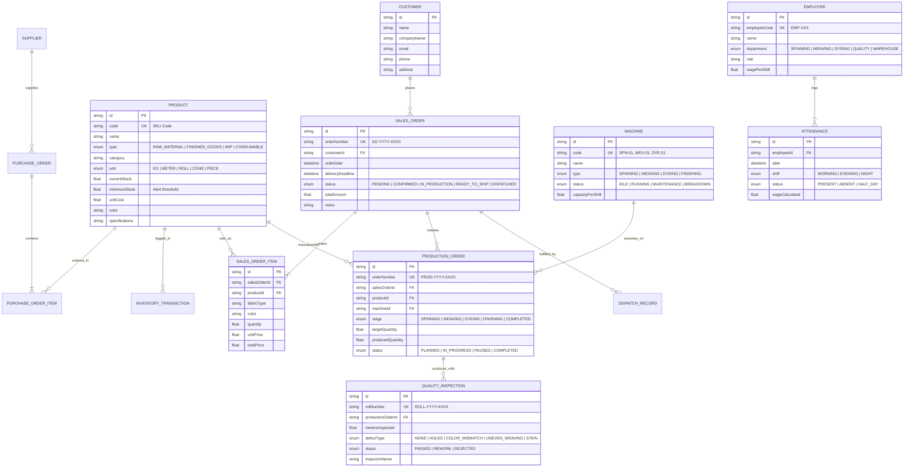

# TextileFlow Data Model Specification

## 1. Overview

The TextileFlow data model supports **Everest Textile Mills**' end-to-end workflow: yarn intake at the gate, spinning, weaving, dyeing, quality roll inspection, finished goods warehousing, sales orders, dispatch, and worker wages.

All models reside in a single schema file (`backend/prisma/schema.prisma`) connected to Supabase PostgreSQL.

---

## 2. Entity Relationship Diagram (ERD)

---

## 3. Detailed Model Definitions & Attributes

### 3.1. Inventory & Catalog (Kishan)
- **`Product` (`products`):**
  - Primary entity for yarn cones, raw cotton, finished fabric rolls, intermediate dye batches, and chemicals.
  - `minimumStock`: Triggers automatic low-stock warnings before factory looms run out of yarn.
  - `currentStock`: Automatically updated via atomic transactions whenever receipts or dispatches occur.
- **`InventoryTransaction` (`inventory_transactions`):**
  - Audit trail of stock movements (`PURCHASE_RECEIPT`, `PRODUCTION_CONSUMPTION`, `PRODUCTION_OUTPUT`, `DISPATCH`, `ADJUSTMENT`).

### 3.2. Sales & Buyer Management (Kishan)
- **`Customer` (`customers`):**
  - Garment factories, fashion labels, and textile export houses placing bulk fabric orders.
- **`SalesOrder` (`sales_orders`):**
  - Master order header recording delivery deadlines, payment status, and order fulfillment states.
- **`SalesOrderItem` (`sales_order_items`):**
  - Line items detailing exact fabric weave (e.g. 12oz Indigo Twill Denim, Pure Cotton Poplin), color shade, ordered meters, and negotiated unit rates.

### 3.3. Procurement & Inward Gate (Kishan)
- **`Supplier` (`suppliers`):**
  - Spinning mills and cotton ginning suppliers delivering raw yarn.
- **`PurchaseOrder` (`purchase_orders`) & `PurchaseOrderItem` (`purchase_order_items`):**
  - Tracks raw material trucks arriving at the mill gate before unloading into stores.

### 3.4. Dispatch & Logistics (Kishan)
- **`DispatchRecord` (`dispatch_records`):**
  - Gate-out pass linking truck vehicle numbers, driver details, inspected fabric roll counts, and delivery invoices.

### 3.5. Factory Operations - Manufacturing (Teammate)
- **`Machine` (`machines`):**
  - Floor assets across spinning frames, air jet weaving looms, and high-temp dyeing jiggers.
  - Status transitions: `IDLE` ↔ `RUNNING` ↔ `MAINTENANCE` ↔ `BREAKDOWN`.
- **`ProductionOrder` (`production_orders`):**
  - Production batch fulfilling a buyer's `SalesOrder` through defined stages (`SPINNING` → `WEAVING` → `DYEING` → `FINISHING`).

### 3.6. Quality Control (Teammate)
- **`QualityInspection` (`quality_inspections`):**
  - Replaces paper slips. Records individual roll inspections, defect categories (`HOLES`, `COLOR_MISMATCH`, `UNEVEN_WEAVING`, `STAIN`), and release decision (`PASSED`, `REWORK`, `REJECTED`).

### 3.7. Human Resources & Shift Attendance (Teammate)
- **`Employee` (`employees`):**
  - Floor operators, weavers, spinners, and QC supervisors with base wage rates per shift.
- **`Attendance` (`attendances`):**
  - Replaces paper muster rolls across 3 shifts (`MORNING`, `EVENING`, `NIGHT`), enforcing composite uniqueness per `[employeeId, date, shift]`.
