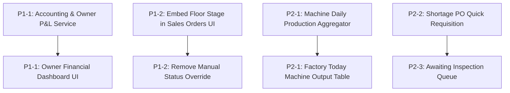

# TextileFlow — Implementation Roadmap

This roadmap categorizes and ranks all identified functional gaps, incomplete features, and missing problem statement requirements into prioritized phases.

---

## Priority Classifications

- **P0 — Critical:** Broken core workflows, data corruption risks, or major blockers. (All previously broken P0 issues such as Dispatch failure and Stock double-deductions are resolved and verified).
- **P1 — High:** Required problem statement functionality missing or incomplete (Costing, Accounting, Owner P&L, Buyer live order stage visibility).
- **P2 — Medium:** Operational workflow enhancements (Machine daily production metrics, PO generation from shortage, Awaiting Inspection queue).
- **P3 — Low:** Polish, reporting exports, and cosmetic adjustments.

---

## 1. P0 — Critical (0 Open Items — All Resolved)

All previously identified critical bugs have been resolved and verified via automated test suites:
- **RESOLVED:** Dispatch gate failure caused by runtime reference errors and misconfigured roll count logic.
- **RESOLVED:** Single-deduction stock enforcement inside atomic database transactions.
- **RESOLVED:** Strict 10-digit buyer phone validation across React and Express.
- **RESOLVED:** Future-only delivery deadline enforcement across React and Express.
- **RESOLVED:** Stripping manual inventory creation and preventing arbitrary stock overwrites in Edit Product.

---

## 2. P1 — High (Core Problem Statement Gaps)

### P1-1: Costing, Accounting & Owner Closing the Books
- **Requirement IDs:** `REQ-ACC-01`, `REQ-ACC-04`, `REQ-ACC-05`
- **Source Requirement:** *"At the end of the month, the owner wants to know what it actually cost to make each order, how much every machine produced, and how much was paid out in worker wages. Raw material bills, worker wages, and payments from buyers all need to come together in one place, so the owner can see, clearly and quickly, whether the mill made money this month."*
- **Affected Files:**
  - Backend: `backend/src/services/accounting.service.js` (New), `backend/src/controllers/accounting.controller.js` (New), `backend/src/routes/accounting.routes.js` (New), [routes/index.js](file:///c:/Users/Kishan/Desktop/Odoo/TextileFlow/backend/src/routes/index.js).
  - Frontend: `frontend/src/components/AccountingView.jsx` (New), [DashboardView.jsx](file:///c:/Users/Kishan/Desktop/Odoo/TextileFlow/frontend/src/components/DashboardView.jsx), [Navbar.jsx](file:///c:/Users/Kishan/Desktop/Odoo/TextileFlow/frontend/src/components/Navbar.jsx), [App.jsx](file:///c:/Users/Kishan/Desktop/Odoo/TextileFlow/frontend/src/App.jsx).
- **Suggested Implementation:**
  1. Build an `accounting.service.js` that aggregates:
     - **Revenue:** Sum of confirmed buyer orders or dispatches for the month (`sales_orders.totalAmount`).
     - **Raw Material Costs:** Sum of purchase order receipts (`purchase_order_items.receivedQty * unitPrice`).
     - **Worker Wages:** Sum of attendance wages paid (`attendances.wageCalculated`) for the month.
     - **Net Profit / Loss:** `Revenue - (Raw Material Costs + Worker Wages)`.
  2. Implement order-level manufacturing costing:
     - Material Cost = Sum of `actualQuantity * rawMaterial.unitCost` from `material_consumptions`.
     - Direct Labor Cost = Operator stage hours/shifts × wage rate.
     - Total Order Cost = Material Cost + Labor Cost.
  3. Render an **Owner Finance & Month-End Closing** dashboard tab displaying the unified P&L metrics with visual indicators (Profit: Green, Loss: Red).
- **Acceptance Criteria:**
  - Owner dashboard shows monthly Billed Revenue, Material Expenses, Wages Paid, and Net Profit/Loss calculated from PostgreSQL records.
  - Selecting any sales order reveals its itemized production cost vs sales value.

### P1-2: Real-time Floor Stage Tracking in Buyer Sales Orders
- **Requirement IDs:** `REQ-SO-03`, `REQ-SO-04`
- **Source Requirement:** *"A buyer wants to know if their fabric is ready and when it will be delivered... The factory should be able to tell a buyer, at any time, exactly where their order stands: whether it is still being woven, being checked, or ready to ship, without anyone having to go and look."*
- **Affected Files:**
  - Frontend: [SalesOrdersView.jsx](file:///c:/Users/Kishan/Desktop/Odoo/TextileFlow/frontend/src/components/SalesOrdersView.jsx).
  - Backend: [sales.service.js](file:///c:/Users/Kishan/Desktop/Odoo/TextileFlow/backend/src/services/sales.service.js), [manufacturing.service.js](file:///c:/Users/Kishan/Desktop/Odoo/TextileFlow/backend/src/services/manufacturing.service.js).
- **Suggested Implementation:**
  1. Integrate the existing backend endpoint `GET /api/manufacturing/status/by-sales-order/:id` into [SalesOrdersView.jsx](file:///c:/Users/Kishan/Desktop/Odoo/TextileFlow/frontend/src/components/SalesOrdersView.jsx).
  2. For every sales order card, display:
     - Current Floor Stage badge: `Weaving`, `Dyeing`, `Finishing`, `Quality Inspection`, `Ready to Ship`, or `Dispatched`.
     - Visual progress bar (% complete).
  3. Remove the arbitrary manual status dropdown from [SalesOrdersView.jsx](file:///c:/Users/Kishan/Desktop/Odoo/TextileFlow/frontend/src/components/SalesOrdersView.jsx) so fulfillment status is strictly derived from real factory execution.
- **Acceptance Criteria:**
  - Moving an order from Spinning to Weaving on the factory floor immediately updates the buyer order view to show "Weaving" without manual status changes.

---

## 3. P2 — Medium (Operational Enhancements)

### P2-1: Machine-Level Daily Production Output Aggregation
- **Requirement IDs:** `REQ-MFG-07`, `REQ-ACC-02`
- **Source Requirement:** *"The factory needs a simple way to see what every machine is doing right now, and how much fabric it has produced today."*
- **Affected Files:**
  - Backend: [manufacturing.service.js](file:///c:/Users/Kishan/Desktop/Odoo/TextileFlow/backend/src/services/manufacturing.service.js).
  - Frontend: [FactoryTodayView.jsx](file:///c:/Users/Kishan/Desktop/Odoo/TextileFlow/frontend/src/components/factory/FactoryTodayView.jsx).
- **Suggested Implementation:**
  1. Add endpoint `GET /api/manufacturing/machines/daily-output?date=YYYY-MM-DD`.
  2. Query `production_stage_logs` where `completedAt >= todayStart` grouped by `machineId` and sum `outputQuantity`.
  3. Render a "Daily Machine Output" table in [FactoryTodayView.jsx](file:///c:/Users/Kishan/Desktop/Odoo/TextileFlow/frontend/src/components/factory/FactoryTodayView.jsx) showing Machine Code, Machine Name, Capacity/Shift, and Output Produced Today (Meters/Kg).
- **Acceptance Criteria:**
  - Completing a weaving stage on `WEV-01` with 300 meters immediately reflects 300 meters under `WEV-01` in the daily machine output report.

### P2-2: Direct PO Requisition from Material Shortage
- **Requirement IDs:** `REQ-RM-06`
- **Source Requirement:** *"When a new order comes in, it should be easy to see whether there is enough yarn to start it, or whether more needs to be ordered first."*
- **Affected Files:**
  - Frontend: [ProductionView.jsx](file:///c:/Users/Kishan/Desktop/Odoo/TextileFlow/frontend/src/components/factory/ProductionView.jsx), [PurchaseOrdersView.jsx](file:///c:/Users/Kishan/Desktop/Odoo/TextileFlow/frontend/src/components/PurchaseOrdersView.jsx).
- **Suggested Implementation:**
  - When material shortage status is `SHORT`, provide a "Reorder Shortage" action button that pre-populates a Purchase Order with the deficit quantity and required material.
- **Acceptance Criteria:**
  - Clicking "Reorder Shortage" opens the PO creation modal with the exact deficient yarn and quantity pre-filled.

### P2-3: Dedicated "Awaiting Inspection" Roll Queue
- **Requirement IDs:** `REQ-QC-03`
- **Source Requirement:** *"The factory needs a clear record of what passed, what failed, and what is waiting to be checked."*
- **Affected Files:**
  - Backend: [quality.service.js](file:///c:/Users/Kishan/Desktop/Odoo/TextileFlow/backend/src/services/quality.service.js).
  - Frontend: [QualityView.jsx](file:///c:/Users/Kishan/Desktop/Odoo/TextileFlow/frontend/src/components/factory/QualityView.jsx).
- **Suggested Implementation:**
  - Query production orders with `producedQuantity > 0` and display outstanding rolls/meters that have not yet had a `QualityInspection` logged.
- **Acceptance Criteria:**
  - Users can clearly see rolls awaiting QC inspection before they are packed and gated.

---

## 4. P3 — Low (Usability & Polish)

### P3-1: Machine Breakdown Reason Logging
- **Requirement IDs:** `REQ-MFG-05`
- **Suggested Implementation:**
  - When setting machine status to `BREAKDOWN`, prompt for an optional breakdown reason (e.g. "Weft yarn breakage", "Motor overheating") and log to a maintenance record.

### P3-2: PDF Gate Pass & Invoice Export
- **Requirement IDs:** `REQ-DSP-04`
- **Suggested Implementation:**
  - Provide a printable/downloadable gate pass summary for confirmed dispatches containing vehicle, driver, roll counts, and buyer destination.

---

## 5. Suggested Implementation Sequence

1. **Step 1:** Implement `accounting.service.js` and Owner Financial View (P1-1). This fulfills the largest unaddressed section of the problem statement.
2. **Step 2:** Wire `getStatusBySalesOrder` into [SalesOrdersView.jsx](file:///c:/Users/Kishan/Desktop/Odoo/TextileFlow/frontend/src/components/SalesOrdersView.jsx) to eliminate manual floor checks (P1-2).
3. **Step 3:** Implement Machine Daily Output Aggregator (P2-1).
4. **Step 4:** Add Shortage Quick-PO action and Awaiting QC Queue (P2-2, P2-3).
